# BCS352 Java Script Introduction Lab — Execution Outputs
**Student:** Krishna Yadav  |  **Student ID:** BCS2025400

## Assignment 1: Your First JavaScript Script

### Question 1
```text
Hello from the script
```
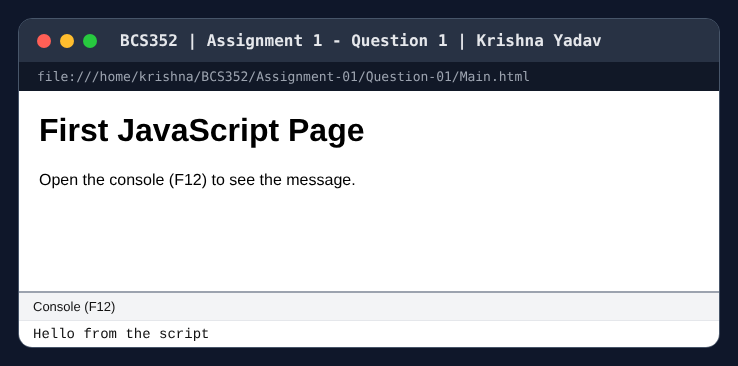

### Question 2
```text
Sample College
2026
```
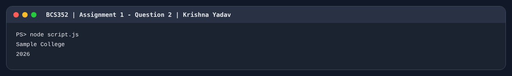

### Question 3
```text
string
number
boolean
```
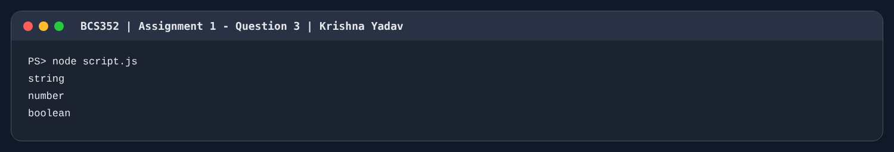

## Assignment 2: Operators, Type Conversion and a Calculator

### Question 1
```text
22
12
85
3.4
```
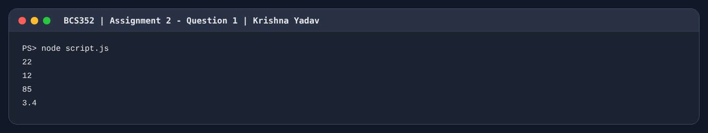

### Question 2
```text
17
73
```


### Question 3
```text
12
4
```
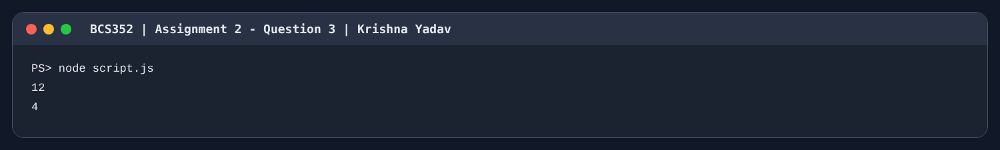

## Assignment 3: Conditions and Loops

### Question 1
```text
Grade B
```


### Question 2
```text
1
2
3
4
5
```
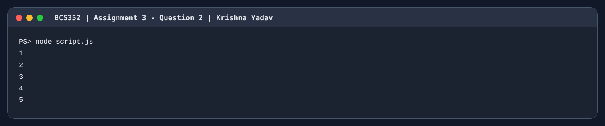

### Question 3
```text
21
```
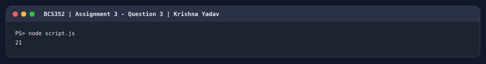

## Assignment 4: Writing Functions

### Question 1
```text
Hello, Asha
```
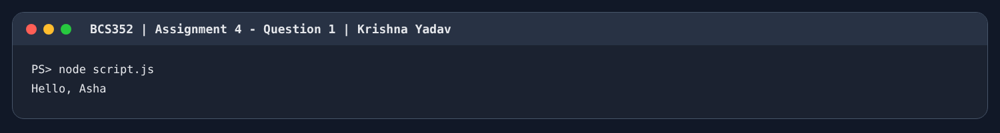

### Question 2
```text
36
```


### Question 3
```text
118
```


## Assignment 5: Arrays, Array Methods and Nested Arrays

### Question 1
```text
4
72
```


### Question 2
```text
Maths
Science
English
```


### Question 3
```text
[ 72, 85, 90 ]
```
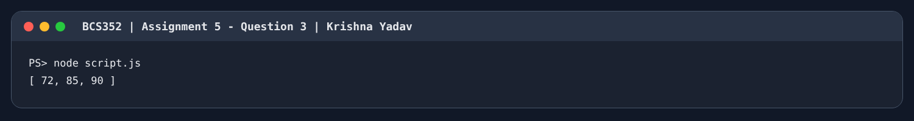

### Question 4
```text
6
```
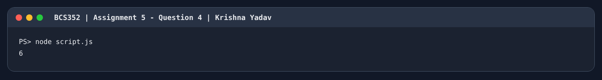

## Assignment 6: JSON Text

### Question 1
```text
{"name":"Rohan","marks":[70,80]}
```
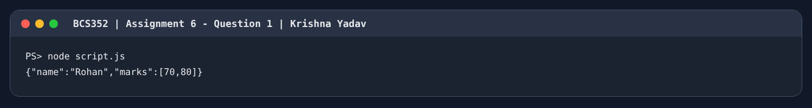

### Question 2
```text
Pune
```


### Question 3
```text
Invalid JSON
```


## Assignment 7: Constructor Functions and Classes

### Question 1
```text
Asha
88
```


### Question 2
```text
Algorithms has 320 pages
```
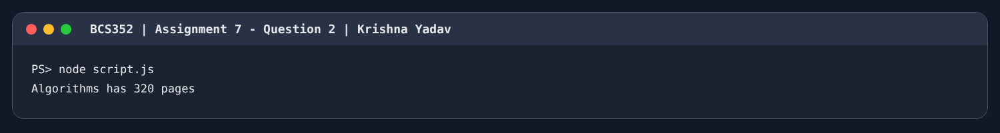

### Question 3
```text
Pass
```


## Assignment 8: Inheritance, Methods and Composition

### Question 1
```text
Hi, I am Anita
```
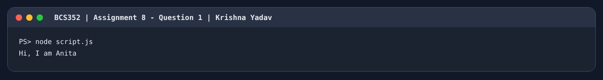

### Question 2
```text
false
true
```
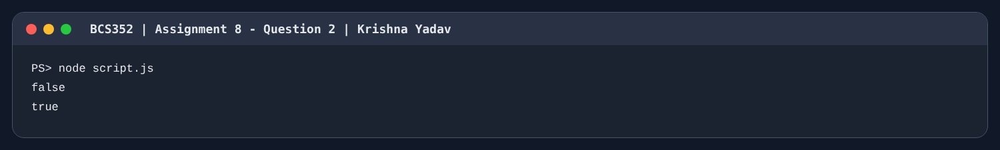

### Question 3
```text
Car starts with 150 HP
```
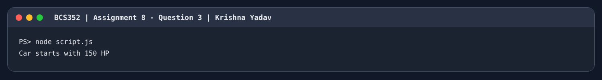

## Assignment 9: DOM, Validation, Storage and Quiz

### Question 1
```text
Heading before click: Welcome
Heading after click: Button clicked
```
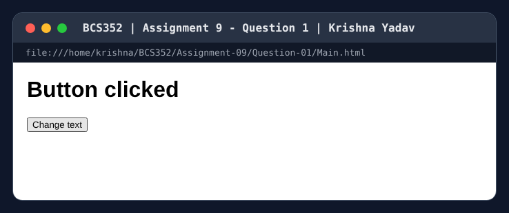

### Question 2
```text
[]
[ 'Name is required' ]
```
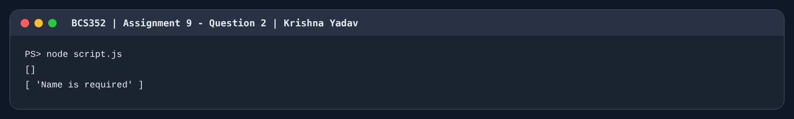

### Question 3
```text
On first open, box value: ''
localStorage note after Save: Submit the lab file on Friday
After reload, box value: 'Submit the lab file on Friday'
```
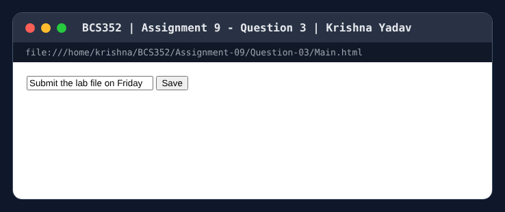

### Question 4
```text
Chosen 5 -> Correct
Chosen 4 -> Try again
```
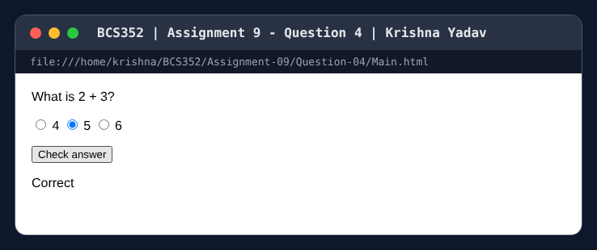

## Assignment 10: Objects and Destructuring

### Question 1
```text
Rohan
81
```


### Question 2
```text
Maths
Science
```
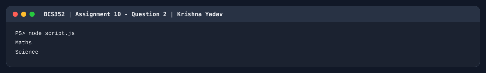

### Question 3
```text
Rohan
12
```
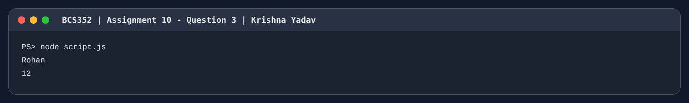

## Assignment 11: Scope and Closures

### Question 1
```text
inner
outer
```
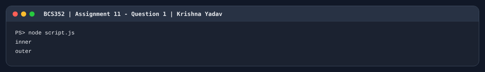

### Question 2
```text
1
2
```
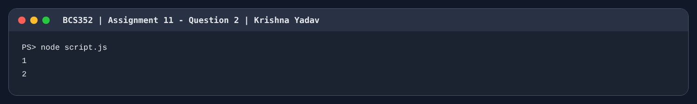

### Question 3
```text
Welcome to Sample College
```


## Assignment 12: Callbacks and Higher-Order Functions

### Question 1
```text
25
```


### Question 2
```text
Marks: 76/100
```
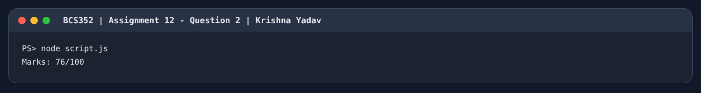

### Question 3
```text
Round 1
Round 2
Round 3
```
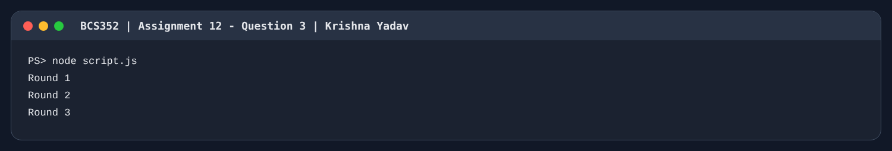

## Assignment 13: Reduce, Some, Every and Map

### Question 1
```text
465
```


### Question 2
```text
true
false
```
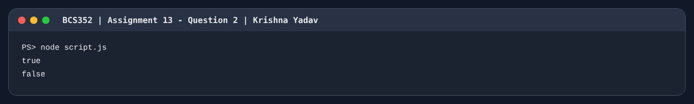

### Question 3
```text
[ 77, 90, 69, 95 ]
[ 72, 85, 64, 90 ]
```
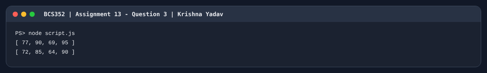

## Assignment 14: Timers and Intervals

### Question 1
```text
Start
End
Timer done
```
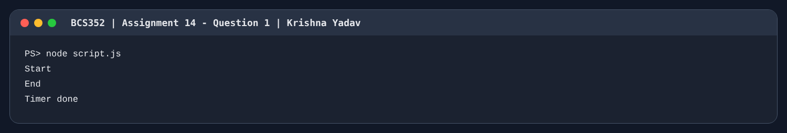

### Question 2
```text
Cancelled
```


### Question 3
```text
Tick 1
Tick 2
Tick 3
```


## Assignment 15: Promises and async/await with Local Data

### Question 1
```text
80
```
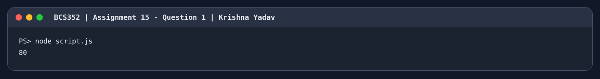

### Question 2
```text
Marks out of range
```
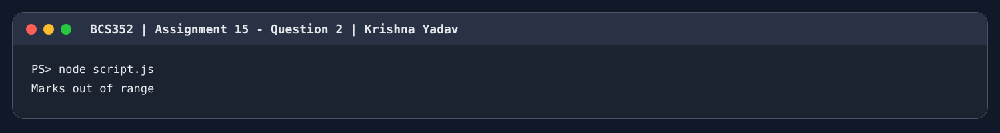

### Question 3
```text
65
Caught: Marks out of range
```
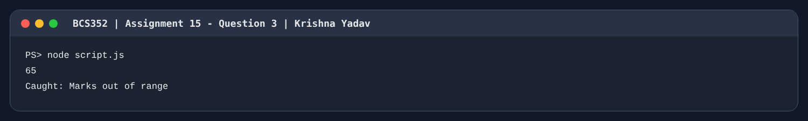

### Question 4
```text
Asha
Rohan
Meera
```
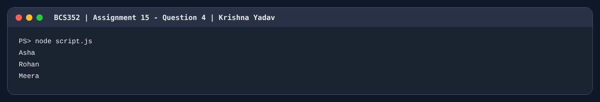
